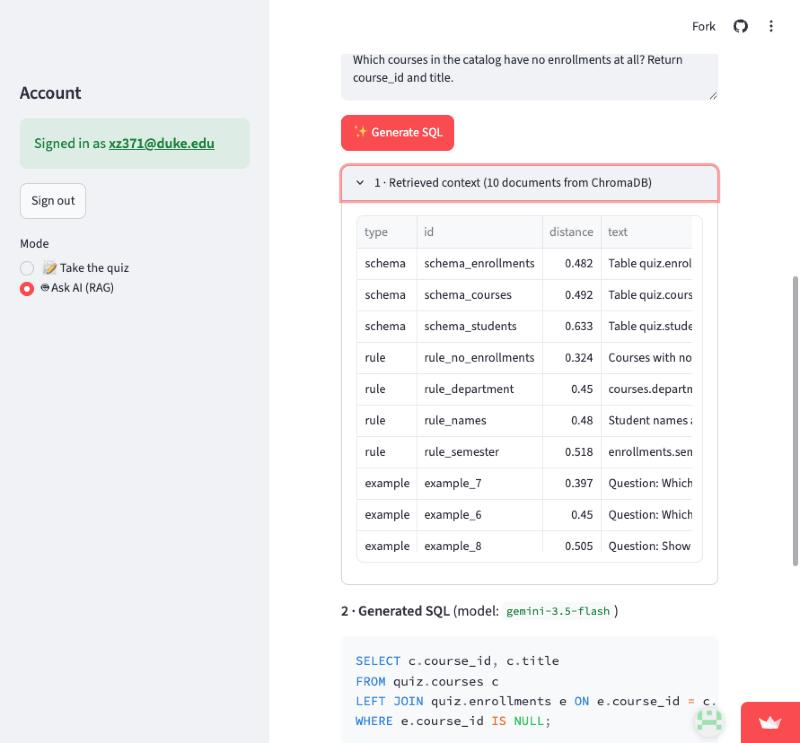
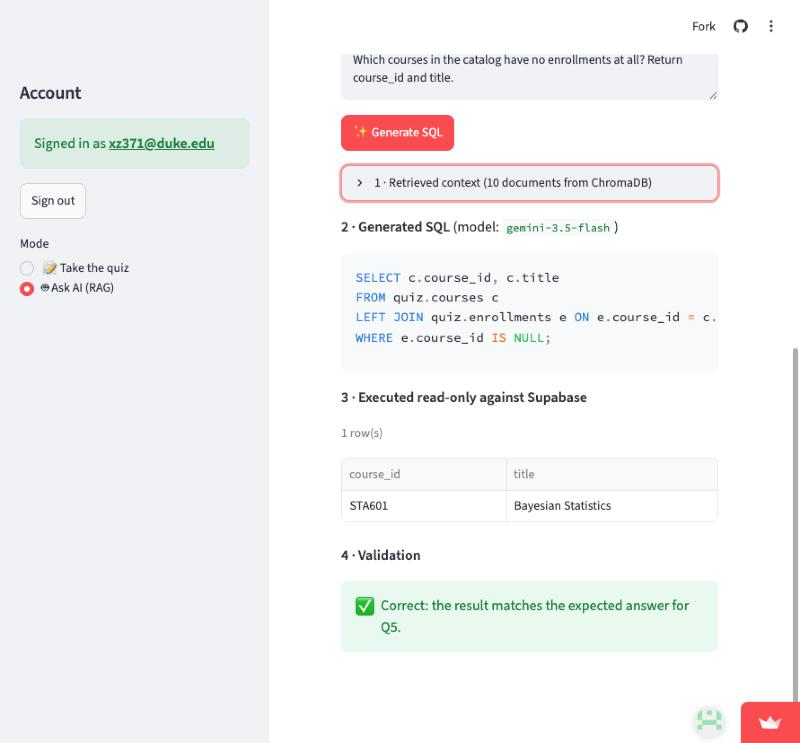

# IDS706 SQL Quiz + RAG Text-to-SQL: Graduate Course Enrollments

[](https://github.com/xuechunz38-stack/IDS706-SQL-Quiz/actions/workflows/ci.yml)

**Quiz site: https://ids706-sql-quiz12.streamlit.app/**

> The free Streamlit tier puts the app to sleep after a period of inactivity. If you see "Zzzz", click **Yes, get this app back up!** and wait a minute or two.

A small TA-style SQL quiz. You sign in, pick a question, type a SQL query, press **Run**, and see the rows it returns from a live PostgreSQL database hosted on Supabase. The quiz has five questions worth 20 points in total. Each question includes a hint with the expected SQL and the expected result.

**Week 8:** the site also has an **🤖 Ask AI (RAG)** mode. You type a question in plain English. The app retrieves relevant schema, business rules and example queries from a **ChromaDB** vector database, and **Google Gemini** turns that context into SQL. The SQL then runs read-only against Supabase, and the result is checked against the quiz answer. See [RAG Text-to-SQL (Week 8)](#rag-text-to-sql-week-8).

## How to take the quiz

1. Open the quiz site above.
2. In the sidebar, open **Sign up**, enter any email and a password (6+ characters), and click **Create account**. Returning users use **Sign in**.
3. Choose a question in the sidebar (Q1 to Q5).
4. Type your SQL in **Your SQL** and click **▶ Run**. The result table appears below the editor. A green banner means your result set matches the expected result.
5. Click **💾 Save answer** to store your query. Your saved answers are listed under **My saved answers**.
6. Open **Hint: expected SQL and expected result** to see the reference query and its output.

While signed out you can read the questions, but **Run** and **Save answer** are disabled. The server checks again that you are signed in before it runs or saves anything.

Grading compares result sets, not SQL text. Column names and row order are ignored; the number of columns and the rows must match.

## The dataset (topic: course enrollments)

| table | columns |
|---|---|
| `quiz.students` (10 rows) | `student_id` (PK), `full_name`, `program` (MIDS / MEM / MBA), `start_year` |
| `quiz.courses` (7 rows) | `course_id` (PK, e.g. `IDS706`), `title`, `department`, `credits` |
| `quiz.enrollments` (27 rows) | `student_id` (FK), `course_id` (FK), `semester` (`Fall 2026` / `Spring 2026`), `grade` (0–100) |

## The questions (20 points)

| # | Topic | Points | Expected result |
|---|---|---|---|
| Q1 | `WHERE` + `ORDER BY`: MIDS students who started in 2025 | 4 | 3 rows: Ava Chen, Ben Okafor, Isla Novak |
| Q2 | `JOIN` + `GROUP BY`: distinct students per course | 4 | 6 rows, IDS706 first with 6 students |
| Q3 | Aggregation: average grade by department, rounded to 1 decimal | 4 | IDS 87.4, FUQ 87.0, ENG 84.9 |
| Q4 | `HAVING`: students taking 3+ courses in Fall 2026 | 4 | Grace Kim 4, Ava Chen 3, Carla Diaz 3, Dev Patel 3 |
| Q5 | What does this `LEFT JOIN ... IS NULL` query return? | 4 | 1 row: STA601 Bayesian Statistics |

The full prompts, hint SQL, and expected results are in [`questions.py`](questions.py). `scripts/seed.py` loads them into `app.questions`.

## Architecture

```
Browser ──► Streamlit app (Streamlit Community Cloud)
              │  sign up / sign in ──► Supabase Auth
              │  quiz taker's SQL  ──► Postgres as quiz_taker (read-only)
              │  questions, saves, audit ──► Postgres as quiz_app (parameterized)
              ▼
         Supabase PostgreSQL (Session pooler, sslmode=require)
              ▲
GitHub Actions ── DATABASE_URL secret ──► scripts/check_db.py (health check)
```

| Requirement | How it is met |
|---|---|
| Hosted PostgreSQL | Supabase project. Schema in [`sql/schema.sql`](sql/schema.sql), data in [`sql/seed.sql`](sql/seed.sql). The app connects through the **Session pooler** with `sslmode=require`. |
| Authentication | Supabase Auth (email + password) in [`app.py`](app.py). Run and Save are disabled when signed out and checked again on the server. |
| GitHub Actions + Secrets | [`.github/workflows/ci.yml`](.github/workflows/ci.yml) runs the unit tests, then `scripts/check_db.py` against the hosted database using `secrets.DATABASE_URL`. No password is in the repository. It runs on every push, on demand, and daily. |
| SQL quiz (20 pts) | 5 × 4-point SQL questions with hints. A signed-in user runs SQL and sees the live result table. |

### Database roles

| Role | Used by | Can do |
|---|---|---|
| `postgres` (owner) | `seed.py`, `check_db.py`, GitHub Actions | Everything (except edit the audit log, see below) |
| `quiz_taker` | SQL typed by quiz takers | `SELECT` on `quiz.*` only. The role is read-only by default, and every query also runs in a read-only transaction with a 5 s timeout. It has no access to `app.*`. |
| `quiz_app` | The app's own queries | `SELECT` questions, `INSERT`/`SELECT` saved answers and audit rows. No `UPDATE`, `DELETE` or `TRUNCATE`. |

The `quiz` and `app` schemas are not exposed through Supabase's REST API, and the `app` tables have row-level security enabled.

## Extra credit

* **Parameterized queries.** Every query the app issues uses bound parameters (`%s`) through psycopg. There is no f-string SQL. Role passwords in `seed.py` are set with `psycopg.sql.Literal`. The only free-form SQL is what the quiz taker types, and it runs as the read-only `quiz_taker` role. `db.check_sql` also allows only a single `SELECT`/`WITH` statement.
* **Audit log.** Every Run (successful or failed) and every Save is written to `app.audit_log`. Each row records the user id and email, the action, the question, the SQL, the row count, success, the error, and a timestamp.
* **Integrity check.**
  * `quiz_taker` has no privileges on schema `app`, so it cannot read or change the log. `quiz_app` can only insert.
  * Triggers block `UPDATE`, `DELETE` and `TRUNCATE` on `app.audit_log` for every role, including the owner.
  * Each row stores a SHA-256 hash of the previous row (`prev_hash` → `row_hash`), forming a hash chain. `scripts/check_db.py` recomputes the chain in CI and fails if any row was edited or removed, even if someone disabled the triggers first. It also checks with `has_table_privilege` that the roles have exactly the intended privileges.

## RAG Text-to-SQL (Week 8)

### Try it

1. Open the site and sign in (or sign up) in the sidebar.
2. In the sidebar, switch **Mode** to **🤖 Ask AI (RAG)**.
3. Pick one of the five quiz questions, or choose **✏️ Ask my own question** and type anything about the data.
4. Click **✨ Generate SQL**. The page shows each step of the pipeline:
   1. **Retrieved context:** the documents ChromaDB returned, with their cosine distances.
   2. **Generated SQL:** the query Gemini wrote from that context.
   3. **Executed read-only:** the result table from Supabase (extra credit).
   4. **Validation:** ✅ or ❌ against the quiz question's expected answer (extra credit).

Screenshots from the deployed site (question Q5):





### Architecture

```
question ─► embed (all-MiniLM-L6-v2, local ONNX) ─► ChromaDB similarity search
                                                       │ top 3 schema docs
                                                       │ top 4 business rules
                                                       │ top 3 few-shot examples
                                                       ▼
                         prompt = system instructions + retrieved context + question
                                                       ▼
                        Google Gemini (gemini-3.5-flash, OpenAI-compatible API)
                                                       ▼
                     generated SQL ─► db.check_sql ─► Postgres as quiz_taker (read-only)
                                                       ▼
                               result table ─► compare with the quiz's expected result
```

| Requirement | How it is met |
|---|---|
| PostgreSQL integration | Reuses the Week 7 Supabase database. The schema documents in the vector store are generated from the live Postgres catalog (`pg_attribute`, `pg_constraint`) together with the distinct values of `program`, `department` and `semester`. Generated SQL runs against the same database. |
| Vector database | **ChromaDB** (in-process, cosine distance) built in [`rag.py`](rag.py). It holds 25 documents: 3 schema docs, 12 business rules and 10 few-shot question/SQL pairs from [`knowledge.py`](knowledge.py). The few-shot questions are deliberately different from the quiz questions. Embeddings use Chroma's default local model, so no embedding API is needed. |
| Retrieval | `rag.retrieve` runs a similarity query per document type and returns the closest documents. Only the retrieved documents go into the prompt. The page shows exactly what was retrieved. |
| AI API | **Google Gemini** through its OpenAI-compatible endpoint (`openai` Python SDK). If the primary model returns 503 or 429, the app falls back to `gemini-3.1-flash-lite` and then `gemini-flash-lite-latest`. Any OpenAI-compatible provider works through `LLM_BASE_URL` / `LLM_MODEL`. (The Duke AI Gateway was the first choice, but it is only reachable from inside Duke's network, so the deployed site could not use it.) |
| Web app | New **Ask AI (RAG)** mode in the existing Streamlit app. It requires sign-in, which also protects the API quota. Each generation is written to the audit log with action `ai`. |
| Extra credit: execution | The SQL passes `db.check_sql` (one `SELECT`/`WITH` only) and runs as the read-only `quiz_taker` role in a read-only transaction with a 5 s timeout. |
| Extra credit: validation | `db.results_match` compares the result set with the quiz question's `hint_result`, ignoring row order and column names. |

### Accuracy

`scripts/check_rag.py` runs the whole pipeline on the five quiz questions. Latest local run with `gemini-3.5-flash`: **5/5 correct**. It runs in GitHub Actions too. When the `LLM_API_KEY` secret is set, the job also generates and validates SQL; otherwise it checks retrieval only.

### Run it locally

```bash
python -m venv .venv && source .venv/bin/activate
pip install -r requirements.txt
cp .env.example .env          # add LLM_API_KEY plus the Week 7 database settings
python scripts/check_rag.py   # retrieval + generation + validation on the 5 quiz questions
streamlit run app.py          # then choose Mode → Ask AI (RAG)
```

On Streamlit Community Cloud, add `LLM_API_KEY = "<key>"` to the app's **Secrets**. The first page load downloads the embedding model (about 80 MB) and builds the vector store; later questions reuse it.

## Repository layout

```
app.py                  Streamlit UI: auth, quiz pages, run/save, Ask AI (RAG) page
db.py                   SQL guard, read-only runner, result comparison
rag.py                  RAG pipeline: schema docs from Postgres, ChromaDB store, retrieval, LLM call
knowledge.py            Business rules and few-shot examples for the vector store
questions.py            The 5 questions with hint SQL, expected results and plain-text versions
sql/schema.sql          Schemas, tables, RLS, audit triggers + hash chain
sql/seed.sql            Dataset
sql/grants.sql          Privileges and RLS policies for quiz_taker / quiz_app
scripts/seed.py         Applies the SQL, loads questions, creates roles
scripts/check_db.py     CI health check against the hosted database
scripts/check_rag.py    End-to-end RAG check (retrieval, generation, validation)
tests/test_db.py        Unit tests (no database needed)
tests/test_rag.py       Unit tests for SQL extraction, prompt building and retrieval
.github/workflows/ci.yml
```

## Set it up yourself

1. **Create a Supabase project** (free tier). Under **Authentication → Sign In / Providers → Email**, turn off **Confirm email** so new users can sign in immediately.
2. **Get the connection details.** Under **Connect → Session pooler**, copy the URI. Under **Project Settings → API**, copy the project URL and the `anon` public key.
3. **Configure locally.**
   ```bash
   python -m venv .venv && source .venv/bin/activate
   make install
   cp .env.example .env        # fill in the values; .env is git-ignored
   ```
   In `.env`, `DATABASE_URL` is the Session pooler URI for `postgres`. Choose `TAKER_PASSWORD` and `APP_PASSWORD`. `APP_DATABASE_URL` and `TAKER_DATABASE_URL` are the same pooler URI with the user replaced by `quiz_app.<project-ref>` / `quiz_taker.<project-ref>` and the matching password.
4. **Load the database:** `make seed`, then `make check`.
5. **Run locally:** `make run` and open http://localhost:8501.
6. **GitHub Actions:** in the repository go to **Settings → Secrets and variables → Actions** and add a secret named `DATABASE_URL` (the owner pooler URI). Push, or run the **CI** workflow manually.
7. **Deploy:** on [share.streamlit.io](https://share.streamlit.io), create an app from this repository with `app.py` as the entry point and Python 3.12. Under **Advanced settings → Secrets**, paste:
   ```toml
   SUPABASE_URL = "https://<project-ref>.supabase.co"
   SUPABASE_ANON_KEY = "<anon key>"
   APP_DATABASE_URL = "postgresql://quiz_app.<project-ref>:<APP_PASSWORD>@<pooler-host>:5432/postgres?sslmode=require"
   TAKER_DATABASE_URL = "postgresql://quiz_taker.<project-ref>:<TAKER_PASSWORD>@<pooler-host>:5432/postgres?sslmode=require"
   ```
   The app never receives the owner password.

## Tests

```bash
make test     # unit tests: SQL guard, result comparison, quiz totals 20 points
make check    # live checks against the database in DATABASE_URL
```
